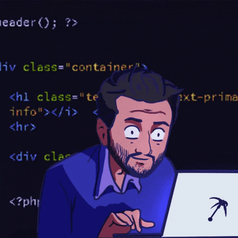

  
  <h1>Hi, I'm Riza</h1>

  

    
    
  

---

### 👨‍💻 About Me

<table>
<tr>
<td width="45%">

</td>
<td width="55%">

  
  
  

 

**🎯 Currently Vibing With**
Web Development | IoT Projects | Security Research | AI Experiments

**🎬 When I'm Not Coding**
Watching Movies | IoT Tinkering | Pentesting Tools

 

🌐 Check out my <a href="https://mysteriza.my.id"><strong>portfolio</strong></a> for projects, resume, and certificates

**🧑‍💻 Currently**
Interning at **Layanan Cerdas Indonesia**, working on web development and monitoring tooling.

</td>
</tr>
</table>

---

<table>
<tr>
<td width="55%">

### 🛠️ Tech Stack

</td>
<td width="45%">

</td>
</tr>
</table>

---

### 🔨 Now Building

| Area | Repository | What it is |
|---|---|---|
| AI | [face-recognition-attendance](https://github.com/sukmanariza/face-recognition-attendance) | Offline face recognition and daily attendance with InsightFace, ONNX Runtime, SQLite, and PySide6 — a learning project |
| Web | [MagangHub-Ekstensi-Monev](https://github.com/sukmanariza/MagangHub-Ekstensi-Monev) | AI-powered Chrome extension that fills Monev attendance for MagangHub interns |
| Firmware | [firmware](https://github.com/sukmanariza/firmware) | Fork of Bruce Firmware (ESP32), where I work on UI/UX and WiFi features |

---

### 📊 GitHub Statistics

  
  

  

---

### ☕ Support Me

  

---

  
⭐️ From <a href="https://mysteriza.my.id">Riza</a>

